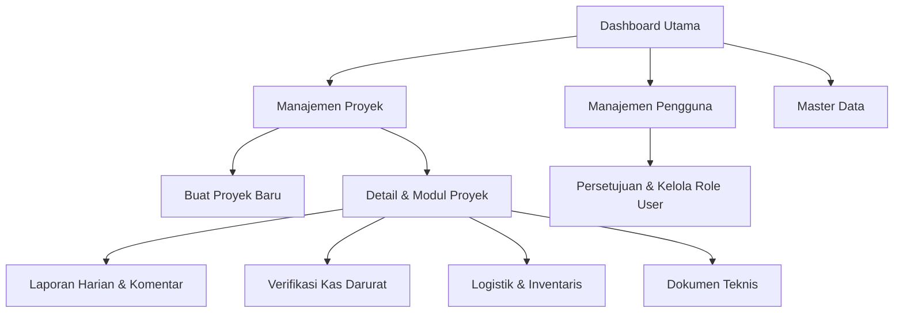
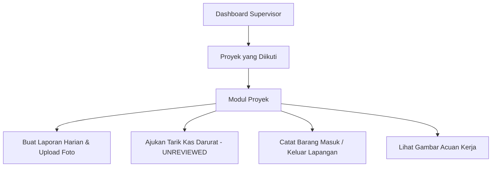
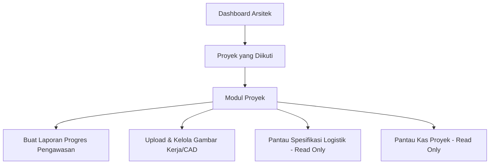
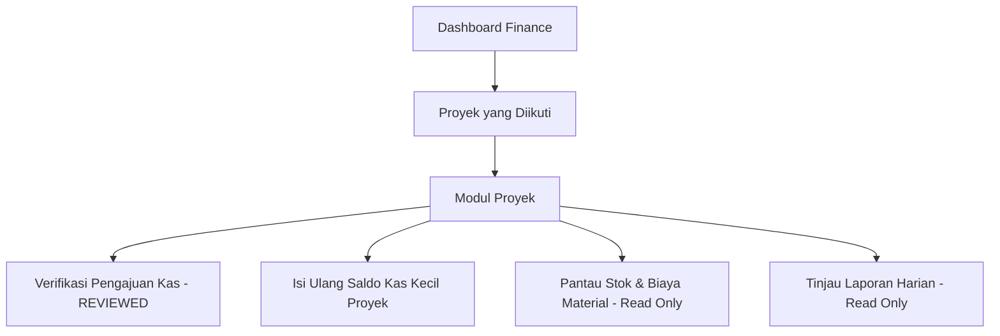
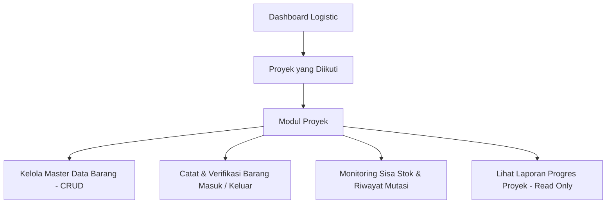

# 🏛️ Sandaran System — System Architecture

> **Dokumen Arsitektur Sistem, Infrastruktur Cloud, Siklus Autentikasi, dan Alur Navigasi Antarmuka.**

---

## 1. Stack Teknologi & Infrastruktur

Sandaran Internal System dibangun dengan teknologi modern yang dioptimalkan untuk kinerja tinggi, keamanan ketat, dan pengalaman pengguna mobile-first:

| Lapisan                | Teknologi                                | Catatan Implementasi                                                                             |
| :--------------------- | :--------------------------------------- | :----------------------------------------------------------------------------------------------- |
| **Framework**          | Next.js 15 (App Router) + React 19       | Server Components secara default; client components hanya untuk interaktivitas (`"use client"`). |
| **Autentikasi**        | Better Auth v1.3 + Prisma Adapter        | Autentikasi berbasis session tersimpan di DB, mendukung multi-role dan approval guard.           |
| **API Layer**          | tRPC v11 + TanStack Query v5 + SuperJSON | End-to-end typesafe API; prosedur terisolasi dalam router fitur.                                 |
| **ORM & Database**     | Prisma v6 + PostgreSQL                   | Migrasi berbasis schema (`schema.prisma`) dengan `DATABASE_URL` (pooled) & `DIRECT_URL`.         |
| **Infrastruktur SaaS** | Platform-Agnostic Node.js Runtime        | Siap di-deploy ke Vercel, Netlify, Railway, Render, atau platform berbasis Node.js lainnya.      |
| **Database Pooling**   | Managed Connection Pooler (PgBouncer)    | Mendukung Transaction Pooler (Supabase / Neon) maupun direct connection di container PaaS.       |
| **Media & Storage**    | Cloudinary v2                            | Direct signed client upload, signed asset deletion, dan manajemen folder per-proyek.             |
| **Styling & UI**       | Tailwind CSS v4 + shadcn/ui (Radix UI)   | Desain token HSL, dark mode via `next-themes`, ikon dari `@tabler/icons-react`.                  |
| **Animasi & Motion**   | GSAP 3 + Lenis Smooth Scroll             | Khusus homepage scrollytelling (`SmoothScrollProvider`).                                         |

---

## 2. Infrastruktur Cloud & Database Connection Pooling

Sistem menggunakan runtime Node.js standar Next.js yang bersifat *platform-agnostic* sehingga dapat di-deploy di berbagai platform SaaS/PaaS tanpa terikat vendor tertentu:

```
[ Browser / Klien ]
       │
       ▼
[ SaaS / PaaS Hosting (Vercel / Netlify / Railway / Render) ]
       │
       │  (Prisma Client Singleton — src/server/db.ts)
       ▼
[ Connection Pooler / PgBouncer (DATABASE_URL) ]
       │
       ▼
[ PostgreSQL Database (Supabase / Neon / Railway PG) ]
```

### Logika Inisialisasi Database (`src/server/db.ts`)

1. **Global Singleton Pattern**: Menggunakan `globalThis.prisma` pada lingkungan development agar *hot-reload* Next.js tidak membuat instance `PrismaClient` berulang kali.
2. **Pemisahan Koneksi Runtime & Migrasi (`prisma/schema.prisma`)**:
   - `DATABASE_URL`: Digunakan oleh aplikasi saat runtime (disarankan menggunakan URL Transaction Pooler / PgBouncer pada platform serverless seperti Vercel atau Netlify).
   - `DIRECT_URL`: Digunakan khusus oleh Prisma CLI saat menjalankan migrasi skema (`pnpm db:migrate` / `prisma migrate deploy`).

---

## 3. Media & File Storage: Cloudinary Pipeline

Seluruh file foto laporan harian, bukti transaksi kas darurat, dan dokumen teknis dikelola melalui Cloudinary:

```
[ Klien / Browser ]
       │
       ├─ 1. Minta Signed Parameters ─────────► [ tRPC: upload.getSignedUploadParams ]
       │                                                     │
       │  ◄── Balas Signature, API Key, Timestamp ───────────┘
       │
       ├─ 2. Direct Upload File (POST) ───────► [ Cloudinary Storage ]
       │                                                     │
       │  ◄── Balas public_id & secure_url ──────────────────┘
       │
       └─ 3. Simpan URL & public_id ke DB ───► [ tRPC Router (report / document) ]
```

- **Pencegahan Orphaned Storage**: Saat dokumen proyek atau bukti transaksi dihapus/diganti, backend secara otomatis memanggil `deleteCloudinaryAsset(publicId)` di Cloudinary sebelum atau bersamaan dengan penghapusan baris data di database.
- **Permanent Storage Key & Cosmetic Dynamic Slug**: Folder Cloudinary disusun per proyek menggunakan kunci permanen (`astaloka/[storageKey]/[type]`), di mana `storageKey = [initial-slug]-[shortId]`. Kunci ini ditetapkan saat proyek pertama kali dibuat dan **tidak pernah di-rename**, menjamin tidak ada aset historis yang menjadi 404 saat nama atau slug proyek diedit. Slug URL web mengikuti pola Notion/Stack Overflow (`[nama-proyek]-[shortId]`) di mana backend mengekstrak `shortId` (10-karakter ID database) untuk identifikasi instan dengan toleransi penuh terhadap URL lama.

---

## 4. Siklus Sesi & Hydration (Authentication Lifecycle)

Sistem menggunakan pola **Server-to-Client Hydration** untuk mendistribusikan data pengguna secara reaktif tanpa _prop drilling_ atau duplikasi permintaan jaringan:

```
[ Server: Root Layout (src/app/layout.tsx) ]
       │
       │  1. auth.api.getSession()
       ▼
[ SessionInitializer Component ]
       │
       │  2. useSessionStore.getState().setSession(session)
       ▼
[ Zustand Store (src/stores/use-session-store.ts) ]
       │
       ├─────────────────────────────────┐
       ▼                                 ▼
[ Client Hook: useSession() ]    [ Client Hook: useUserRole() ]
- Data user (nama, email, foto)  - Status Admin & Executive
- Status akun (isActive)         - Hitung Project Roles (isSupervisor,
                                   isArchitect, isFinance, isLogistic)
```

### Route Protection Helpers

| Helper           | File                         | Lingkungan                  | Tujuan                                                                                       |
| :--------------- | :--------------------------- | :-------------------------- | :------------------------------------------------------------------------------------------- |
| `requireAuth()`  | `src/lib/server-auth.ts`     | Server Components / Actions | Memastikan pengguna login & aktif. Mengarahkan ke `/login` atau `/waiting-approval`.         |
| `requireAdmin()` | `src/lib/server-auth.ts`     | Server Components / Actions | Memastikan role pengguna adalah `ADMIN` atau `EXECUTIVE` (sebelumnya `CEO`).                 |
| `useUserRole()`  | `src/hooks/use-user-role.ts` | Client Components           | Menyediakan boolean status role proyek untuk kondisional rendering UI (`isSupervisor`, dll). |
| `isAdmin(role)`  | `src/lib/auth-guards.ts`     | Server & Client             | Pure helper untuk memeriksa apakah role adalah `ADMIN` atau `EXECUTIVE` (sebelumnya `CEO`).  |

---

## 5. Peta Alur Antarmuka (UI Flow Map per Role)

Akses navigasi dan menu UI disesuaikan secara granular berdasarkan peran pengguna:

### A. Admin & Executive Flow

Admin dan Executive memiliki pandangan menyeluruh ke seluruh sistem. Executive memiliki akses pemantauan dan administratif serupa Admin:



### B. Supervisor Flow

Supervisor (sebelumnya Mandor) beroperasi di lapangan dalam proyek yang ditugaskan:



### C. Architect Flow

Arsitek mengawasi kesesuaian gambar dan spesifikasi desain:



### D. Finance Flow

Finance mengontrol anggaran kas kecil dan memantau biaya material:



### E. Logistic Flow

Logistic mengelola rantai pasok material dan inventaris gudang:



---

## 6. Ekspor Laporan Bulanan (Excel API Route)

- **Endpoint:** `GET /api/projects/[id]/export?month=YYYY-MM` ([`route.ts`](../src/app/api/projects/[id]/export/route.ts))
- **Otorisasi:** Terbatas untuk `ADMIN` dan `EXECUTIVE` (read-only portfolio oversight).
- **Logika:** Memvalidasi format bulan ketat (`01–12`), menghitung rentang tanggal dalam zona waktu WITA (`UTC+8`), lalu menghasilkan file `.xlsx` via `exceljs` dengan sanitasi teks formula spreadsheet.
