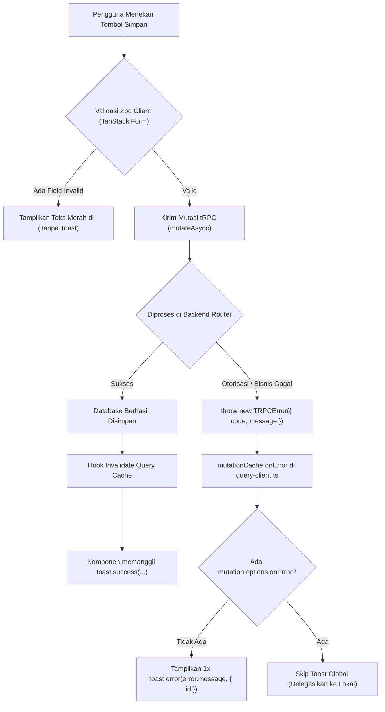

# 📐 Sandaran System — Coding Standards & Best Practices

> **Single Source of Truth** untuk arsitektur tRPC, TanStack Query, TanStack Form, Zod, dan pencegahan Anti-Pattern (*Code Smell*).

---

## 1. Prinsip Utama & Arsitektur 3-Layer

Sistem Sandaran menerapkan pemisahan tanggung jawab yang tegas (*Separation of Concerns*) melalui 3 lapisan utama:

```
[ Layer 1: Backend Router ]  ── Menyediakan data, validasi Zod, dan melempar TRPCError informatif
           │
           ▼
[ Layer 2: Custom Hooks ]    ── Wrapper tipis di atas tRPC & orkestrasi cache invalidation / optimistic update
           │
           ▼
[ Layer 3: Form & UI ]       ── Interaksi pengguna, inline field validation, dan penanganan feedback sukses
```

> **Aturan Emas Penanganan Error:**
> Pesan kesalahan bisnis berasal dari **Router**, dialirkan melalui **Wire tRPC**, dan ditampilkan ke layar pengguna secara otomatis oleh **`MutationCache` Global** di [src/trpc/query-client.ts](file:///d:/Haqqi%20Sukmara/NextJS/sandaran-internal-system/src/trpc/query-client.ts). Komponen UI **tidak boleh** membuat `toast.error` ganda yang menimpa pesan server.

---

## 2. Standar Router (tRPC v11 & Prisma v6)

Router bertanggung jawab atas otorisasi, sanitasi input, transaksi basis data, dan integritas data.

### 2.1 Prosedur Berlapis (*Layered Guards*)
Gunakan prosedur bawaan di [src/server/api/trpc.ts](file:///d:/Haqqi%20Sukmara/NextJS/sandaran-internal-system/src/server/api/trpc.ts) sesuai konteks otorisasi:

| Prosedur | Otorisasi & Peran | Penggunaan |
| :--- | :--- | :--- |
| `publicProcedure` | Siapa saja (termasuk tanpa login) | Endpoint publik (cek slug, status server). |
| `protectedProcedure` | Pengguna login & akun aktif (`isActive = true`) | Operasi profil sendiri, notifikasi personal. |
| `adminProcedure` | Role `ADMIN` dan `EXECUTIVE` | Manajemen pengguna, pembacaan seluruh data sistem. |
| `strictAdminProcedure` | Khusus role `ADMIN` | Aksi destruktif/kritis (hapus proyek, reset kata sandi, ubah admin). |
| `projectProcedure(roles)` | Anggota proyek dengan peran tertentu | Operasi di dalam proyek (Laporan, Dokumen, Kas Darurat, Logistik). |

```ts
// ✅ CONTOH: Menggunakan guard berbasis peran proyek
export const reportRouter = createTRPCRouter({
  create: projectProcedure(["SUPERVISOR", "ARCHITECT"])
    .input(createReportSchema)
    .mutation(async ({ ctx, input }) => {
      // ctx.projectId dan ctx.projectRole otomatis tersedia dan tervalidasi
      return ctx.db.dailyReport.create({ ... });
    }),
});
```

### 2.2 Validasi Input Zod Ketat
Setiap input prosedur wajib divalidasi batas dan formatnya menggunakan Zod:
- String teks wajib menggunakan `.trim()`.
- Wajib menyertakan `.min()` dan `.max()` untuk mencegah *payload injection* / *DoS*.
- Gunakan enum Zod (`z.enum(...)`) untuk tipe diskrit.

```ts
// ✅ CONTOH: Validasi input yang aman dan defensif
.input(
  z.object({
    projectId: z.string().cuid(),
    name: z.string().trim().min(1, "Nama tidak boleh kosong").max(100, "Nama maksimal 100 karakter"),
    unit: z.string().trim().min(1).max(20),
  })
)
```

### 2.3 Standar Melempar Error (`TRPCError`)
1. **Dilarang** melempar `new Error()`. Selalu gunakan `new TRPCError({ code, message })`.
2. Gunakan kode status RPC semantik:
   - `BAD_REQUEST`: Input tidak valid, stok kurang, saldo tidak cukup.
   - `FORBIDDEN`: Bukan pemilik data, peran tidak memenuhi syarat.
   - `NOT_FOUND`: Rekord database tidak ditemukan.
   - `UNAUTHORIZED`: Belum login atau sesi kedaluwarsa.
3. Pesan error (`message`) wajib berupa **kalimat bahasa Indonesia yang jelas dan ramah pengguna**, karena pesan ini langsung ditampilkan di toast frontend.

```ts
// ✅ CONTOH: Pesan error informatif
if (input.quantity > currentStock) {
  throw new TRPCError({
    code: "BAD_REQUEST",
    message: `Stok tidak mencukupi. Stok saat ini: ${currentStock} ${item.unit}`,
  });
}
```

### 2.4 Helper Kepemilikan Terpusat (`requireOwnership`)
Untuk data yang hanya boleh diubah/dihapus oleh pembuatnya (misal laporan, dokumen, komentar), gunakan helper [requireOwnership](file:///d:/Haqqi%20Sukmara/NextJS/sandaran-internal-system/src/server/api/helpers/permission.ts):

```ts
import { requireOwnership } from "~/server/api/helpers/permission";

// Admin otomatis bypass, sedangkan user non-admin dicek kepemilikannya
requireOwnership(
  report,
  ctx.session.user.id,
  ctx.session.user.roleGlobal,
  "Hanya pembuat laporan yang dapat mengubah data ini"
);
```

> **Golden Reference Router:**
> - [src/server/api/routers/logistic.router.ts](file:///d:/Haqqi%20Sukmara/NextJS/sandaran-internal-system/src/server/api/routers/logistic.router.ts)
> - [src/server/api/routers/report.router.ts](file:///d:/Haqqi%20Sukmara/NextJS/sandaran-internal-system/src/server/api/routers/report.router.ts)

---

## 3. Standar Custom Hooks (TanStack Query v5)

Hooks bertindak sebagai jembatan data yang bersih antara API tRPC dan komponen React.

### 3.1 Wrapper Query Tipis dengan Guard `enabled`
Untuk query data yang bergantung pada parameter ID atau slug, selalu tambahkan guard `enabled: !!id` agar tidak memicu pemanggilan request saat nilai parameter masih kosong/undefined:

```ts
// ✅ STANDAR: Hook query dengan parameter guard
export function useProject(projectId: string) {
  return api.project.getById.useQuery(
    { projectId },
    { enabled: Boolean(projectId) }
  );
}

export function useProjectBySlug(slug: string) {
  return api.project.getBySlug.useQuery(
    { slug },
    { enabled: Boolean(slug) }
  );
}
```

### 3.2 Wrapper Mutasi Standar (Hanya Invalidate Cache)
Hook mutasi **hanya** bertugas memicu mutasi dan menyinkronkan cache TanStack Query. **DILARANG** menaruh `toast.success` atau `toast.error` di dalam custom hook.

```ts
// ✅ STANDAR: Hook mutasi bersih tanpa efek samping UI
export function useCreateProject() {
  const utils = api.useUtils();
  return api.project.create.useMutation({
    onSuccess: () => {
      void utils.project.getAll.invalidate();
      void utils.dashboard.invalidate();
    },
  });
}
```

### 3.3 Pola Optimistic Updates Standar
Untuk antarmuka yang memerlukan responsivitas instan (seperti penambahan item logistik atau reordering), terapkan siklus 3-tahap TanStack Query:

1. **`onMutate`**: Batalkan query berjalan, simpan snapshot data lama (*rollback context*), dan perbarui cache lokal secara optimistik.
2. **`onError`**: Kembalikan cache ke snapshot lama jika mutasi server gagal.
3. **`onSettled`**: Invalidate query ke server agar data lokal kembali 100% sinkron dengan database.

```ts
// ✅ STANDAR: Optimistic update dengan rollback aman (dari useLogistic.ts)
export function useCreateLogisticItem() {
  const utils = api.useUtils();

  return api.logistic.createItem.useMutation({
    onMutate: async (newItem) => {
      await utils.logistic.getItems.cancel({ projectId: newItem.projectId });
      const previousItems = utils.logistic.getItems.getData({ projectId: newItem.projectId });

      if (previousItems) {
        utils.logistic.getItems.setData(
          { projectId: newItem.projectId },
          [
            ...previousItems,
            {
              id: `temp-id-${Date.now()}`,
              projectId: newItem.projectId,
              name: newItem.name,
              unit: newItem.unit,
              createdAt: new Date(),
              _count: { transactions: 0 },
            },
          ].sort((a, b) => a.name.localeCompare(b.name))
        );
      }

      return { previousItems };
    },
    onError: (_err, newItem, context) => {
      // Rollback ke kondisi sebelum mutasi
      if (context?.previousItems) {
        utils.logistic.getItems.setData(
          { projectId: newItem.projectId },
          context.previousItems
        );
      }
    },
    onSettled: (_data, _error, variables) => {
      // Selalu sinkronkan ulang dengan database
      void utils.logistic.getItems.invalidate({ projectId: variables.projectId });
    },
  });
}
```

> **Golden Reference Hooks:**
> - [src/hooks/useProject.ts](file:///d:/Haqqi%20Sukmara/NextJS/sandaran-internal-system/src/hooks/useProject.ts) — Contoh hook bersih tanpa efek samping UI.
> - [src/hooks/useLogistic.ts:40-80](file:///d:/Haqqi%20Sukmara/NextJS/sandaran-internal-system/src/hooks/useLogistic.ts#L40-L80) — Contoh implementasi optimistic update standar industri.

---

## 4. Standar Form & Dialog (TanStack Form, Zod & Radix)

Komponen form bertanggung jawab atas interaksi formulir, umpan balik validasi, dan penyampaian aksi pengguna.

### 4.1 Skema Zod sebagai Satu-Satunya Sumber Kebenaran (*Single Source of Truth*)
1. Definisikan skema form dengan Zod di file komponen atau file `*-schemas.ts`.
2. Ekstrak tipe form menggunakan `z.infer<typeof schema>`.
3. Hubungkan ke TanStack Form via `validators: { onSubmit: formSchema }`.

```ts
export const projectSchema = z.object({
  name: z.string().trim().min(1, "Nama proyek wajib diisi").max(100),
  description: z.string().trim().max(3000).optional(),
});

export type ProjectFormValues = z.infer<typeof projectSchema>;
```

### 4.2 Validasi Input = Inline `<FieldError />` (Bukan Toast!)
- Kesalahan pengisian kolom (seperti format email tidak valid atau kolom kosong) ditampilkan **tepat di bawah kolom input terkait** menggunakan `<FieldError errors={field.state.meta.errors} />`.
- Jangan pernah memunculkan `toast.error` saat pengguna lupa mengisi kolom form.

```tsx
<form.Field name="name">
  {(field) => (
    <Field data-invalid={field.state.meta.isTouched && !field.state.meta.isValid}>
      <FieldLabel htmlFor={field.name}>Nama Proyek *</FieldLabel>
      <Input
        id={field.name}
        value={field.state.value}
        onBlur={field.handleBlur}
        onChange={(e) => field.handleChange(e.target.value)}
      />
      <FieldError errors={field.state.meta.errors} />
    </Field>
  )}
</form.Field>
```

### 4.3 Pola `ResponsiveFormDialog` (Pola 3-Zona)
Untuk form di dalam dialog/drawer, selalu gunakan [ResponsiveFormDialog](file:///d:/Haqqi%20Sukmara/NextJS/sandaran-internal-system/src/components/shared/responsive-form-dialog.tsx) yang telah mengisolasi:
1. **Header**: Judul & deskripsi (fixed/shrink-0).
2. **Body**: Form input scrollable dengan atribut `data-vaul-no-drag`.
3. **Footer**: Tombol aksi di luar form yang terikat via atribut HTML `form="formId"`.

```tsx
<ResponsiveFormDialog
  open={open}
  onOpenChange={setOpen}
  title="Tambah Proyek"
  formId="project-form"
  submitLabel={createProject.isPending ? "Menyimpan..." : "Simpan Proyek"}
  isPending={createProject.isPending}
>
  <form
    id="project-form"
    onSubmit={(e) => {
      e.preventDefault();
      e.stopPropagation();
      void form.handleSubmit();
    }}
    className="space-y-4"
  >
    {/* Kolom-kolom Form */}
  </form>
</ResponsiveFormDialog>
```

### 4.4 Standar Penanganan Sukses & Error pada Submit
```tsx
onSubmit: async ({ value }) => {
  try {
    await mutation.mutateAsync(value);
    
    // 1. Toast SUKSES ditangani di sini karena hanya komponen yang tahu kalimat keberhasilannya
    toast.success("Data berhasil diperbarui");
    
    // 2. Tutup dialog atau reset form
    onSuccess?.();
  } catch {
    // 3. Error toast TIDAK perlu dipanggil di sini!
    // Global mutationCache di query-client.ts otomatis menangkapnya dan menampilkan pesan asli server.
    // Blok catch ini hanya bertugas mencegah uncaught promise rejection.
  }
}
```

> **Golden Reference Forms:**
> - [src/components/project/project-form.tsx:113-144](file:///d:/Haqqi%20Sukmara/NextJS/sandaran-internal-system/src/components/project/project-form.tsx#L113-L144)
> - [src/app/(internal)/projects/projects-client.tsx:82-91](file:///d:/Haqqi%20Sukmara/NextJS/sandaran-internal-system/src/app/%28internal%29/projects/projects-client.tsx#L82-L91)
> - [src/app/(internal)/projects/[slug]/documents/documents-client.tsx](file:///d:/Haqqi%20Sukmara/NextJS/sandaran-internal-system/src/app/%28internal%29/projects/%5Bslug%5D/documents/documents-client.tsx)
> - [src/components/project/member-management.tsx](file:///d:/Haqqi%20Sukmara/NextJS/sandaran-internal-system/src/components/project/member-management.tsx)

---

## 5. Ringkasan Anti-Pattern (*Code Smell Checklist*)

Sebelum melakukan commit atau PR, periksa kode Anda terhadap daftar pantangan berikut:

| ❌ Anti-Pattern (*Dilarang*) | ✅ Pola Standar Sandaran | Mengapa? |
| :--- | :--- | :--- |
| **Double Toasting**:<br>`catch (err) { toast.error(err.message); }` | `catch { /* Ditangani global */ }` | Menghindari 2 kartu toast bertumpuk di layar. |
| **Menimpa Pesan Spesifik Server**:<br>`catch { toast.error("Gagal menyimpan"); }` | Biarkan pesan server muncul via `mutationCache`. | Pengguna berhak tahu alasan pasti kegagalan (misal: "Stok kurang" bukan sekadar "Gagal"). |
| **Toast pada Custom Hook**:<br>Menaruh `toast.success` di `useMutation`. | Pasang `toast.success` di komponen pemanggil. | Hook harus *reusable* dan bebas efek samping UI visual. |
| **Query Tanpa Guard**:<br>`useQuery({ id })` saat `id` bisa bernilai `undefined`. | `useQuery({ id }, { enabled: !!id })` | Mencegah query menembak API dengan parameter kosong dan memicu log error 400. |
| **Toast Validasi Input**:<br>`if (!name) toast.error("Nama wajib")` | Gunakan skema Zod + `<FieldError />` inline. | Input validation harus terlihat langsung di samping field yang bermasalah. |
| **Uncontrolled to Controlled Warning**:<br>`form.reset` melewatkan salah satu field. | Selalu sediakan string kosong `""` atau fallback `value={val ?? ""}`. | Mencegah React warning konsol saat modal dibuka-tutup. |

---

## 6. Diagram Alur Error Handling


