# 🗄️ Sandaran Internal System — Entity Relationship Diagram (ERD)

> **Dokumentasi Skema Database Relasional (PostgreSQL & Prisma ORM v6) untuk Sandaran Internal System.**  
> Sumber kebenaran skema: [`prisma/schema.prisma`](../prisma/schema.prisma)

---

## 1. Ringkasan Arsitektur Database

Database **Sandaran Internal System** menggunakan **PostgreSQL** yang diakses melalui **Prisma ORM v6** (dengan dukungan **Cloudflare Hyperdrive** untuk _connection pooling_ di lingkungan Edge/Serverless). Secara struktural, skema database terdiri atas **15 tabel (model)** dan **7 tipe enumerasi (`enum`)** yang terbagi ke dalam dua kelompok fungsional:

1. **Kelompok Autentikasi & Identitas (Better Auth + RBAC Global):**
   - `User` (`@@map("user")`)
   - `Session` (`@@map("session")`)
   - `Account` (`@@map("account")`)
   - `Verification` (`@@map("verification")`)
2. **Kelompok Operasional Proyek Konstruksi:**
   - **Inti Proyek & Keanggotaan:** `Project`, `ProjectMember`
   - **Pelaporan Harian & Diskusi:** `DailyReport`, `DailyReportTask`, `ReportMedia`, `ReportComment`
   - **Dokumen Teknis & Arsitektur:** `ProjectDocument`
   - **Kas Darurat (Emergency Fund):** `EmergencyFund`, `EmergencyTransaction`
   - **Logistik & Inventaris Material:** `LogisticItem`, `LogisticTransaction`

---

## 2. Full Entity Relationship Diagram (ERD)

Diagram di bawah ini memetakan seluruh model, atribut, _Primary Key_ (`PK`), _Foreign Key_ (`FK`), _Unique Key_ (`UK`), serta kardinalitas relasi antar-entitas secara utuh.

```mermaid
erDiagram
    %% ==========================================
    %% ENTITAS AUTENTIKASI & PENGGUNA
    %% ==========================================
    User {
        String id PK "UUID / ID Pengguna"
        String name "Nama lengkap"
        String email UK "Email unik pengguna"
        Boolean emailVerified "Default: false"
        String image "Nullable - URL foto profil"
        String phoneNumber UK "Nullable - Nomor telepon unik"
        Boolean phoneNumberVerified "Nullable, Default: false"
        GlobalRole roleGlobal "Default: NONE (ADMIN | EXECUTIVE | USER | NONE)"
        Boolean isActive "Default: false (Status aktivasi akun)"
        DateTime reviewedAt "Nullable - Waktu tinjauan/approval"
        String reviewedById FK "Nullable - Self-reference ke User (Reviewer)"
        DateTime createdAt "Default: now()"
        DateTime updatedAt "Default: now(), @updatedAt"
    }

    Session {
        String id PK "ID Sesi"
        DateTime expiresAt "Waktu kedaluwarsa sesi"
        String token UK "Token sesi unik"
        DateTime createdAt "Default: now()"
        DateTime updatedAt "@updatedAt"
        String ipAddress "Nullable - Alamat IP klien"
        String userAgent "Nullable - Informasi browser/perangkat"
        String userId FK "Ref: User.id (onDelete: Cascade)"
    }

    Account {
        String id PK "ID Akun Provider"
        String accountId "ID dari provider / credential"
        String providerId "e.g., credential, google"
        String userId FK "Ref: User.id (onDelete: Cascade)"
        String accessToken "Nullable - OAuth Access Token"
        String refreshToken "Nullable - OAuth Refresh Token"
        String idToken "Nullable - OAuth ID Token"
        DateTime accessTokenExpiresAt "Nullable"
        DateTime refreshTokenExpiresAt "Nullable"
        String scope "Nullable"
        String password "Nullable - Hashed password (credential)"
        DateTime createdAt "Default: now()"
        DateTime updatedAt "@updatedAt"
    }

    Verification {
        String id PK "ID Verifikasi"
        String identifier "Target verifikasi (email/phone)"
        String value "Token / kode OTP"
        DateTime expiresAt "Waktu kedaluwarsa"
        DateTime createdAt "Default: now()"
        DateTime updatedAt "Default: now(), @updatedAt"
    }

    %% ==========================================
    %% ENTITAS INTI PROYEK & TIM
    %% ==========================================
    Project {
        String id PK "Default: cuid()"
        String name "Nama proyek"
        String slug UK "Slug URL dinamis (nama-proyek-shortId)"
        String shortId UK "Nullable - 10 karakter ID unik"
        String storageKey UK "Nullable - Folder permanen Cloudinary"
        String description "Nullable - @db.Text"
        String location "Nullable - Lokasi proyek"
        DateTime startDate "Nullable - Tanggal mulai"
        DateTime endDate "Nullable - Target selesai"
        ProjectStatus status "Default: ACTIVE (ACTIVE | DONE | PAUSED)"
        DateTime createdAt "Default: now()"
        DateTime updatedAt "@updatedAt"
    }

    ProjectMember {
        String id PK "Default: cuid()"
        String userId FK "Ref: User.id (onDelete: Cascade)"
        String projectId FK "Ref: Project.id (onDelete: Cascade)"
        ProjectRole role "SUPERVISOR | ARCHITECT | FINANCE | LOGISTIC"
        DateTime createdAt "Default: now() | UK: (userId, projectId)"
    }

    %% ==========================================
    %% ENTITAS LAPORAN HARIAN & DISKUSI
    %% ==========================================
    DailyReport {
        String id PK "Default: cuid()"
        String slug "UK komposit: (projectId, slug)"
        String projectId FK "Ref: Project.id"
        String userId FK "Ref: User.id (Pembuat laporan)"
        DateTime reportDate "Default: now()"
        String taskDescription "@db.Text - Ringkasan pekerjaan"
        Int progressPercent "Default: 0 (0-100%)"
        String issues "Nullable - @db.Text (Kendala lapangan)"
        String weather "Nullable - Kondisi cuaca"
        Int totalWorkers "Default: 0 (Total pekerja hari ini)"
        String location "Nullable - Area kerja spesifik"
        DateTime createdAt "Default: now()"
    }

    DailyReportTask {
        String id PK "Default: cuid()"
        String reportId FK "Ref: DailyReport.id (onDelete: Cascade)"
        String taskName "Nama item pekerjaan"
        Int workerCount "Default: 0 (Jumlah pekerja)"
        Int progress "Default: 0 (Progress 0-100%)"
        String notes "Nullable - @db.Text"
        DateTime createdAt "Default: now()"
        DateTime updatedAt "@updatedAt"
    }

    ReportMedia {
        String id PK "Default: cuid()"
        String reportId FK "Ref: DailyReport.id (onDelete: Cascade)"
        String publicId "Cloudinary Public ID"
        String url "Cloudinary Secure URL"
        String resourceType "Default: image (image | video | raw)"
        String fileName "Nullable - Nama file asli"
        Int fileSize "Nullable - Ukuran file (bytes)"
        String mimeType "Nullable - Tipe MIME"
        DateTime createdAt "Default: now()"
    }

    ReportComment {
        String id PK "Default: cuid()"
        String reportId FK "Ref: DailyReport.id (onDelete: Cascade)"
        String userId FK "Ref: User.id (Penulis komentar)"
        String content "@db.Text - Isi komentar"
        DateTime createdAt "Default: now()"
        DateTime updatedAt "@updatedAt"
    }

    %% ==========================================
    %% ENTITAS DOKUMEN TEKNIS PROYEK
    %% ==========================================
    ProjectDocument {
        String id PK "Default: cuid()"
        String projectId FK "Ref: Project.id (onDelete: Cascade)"
        String userId FK "Ref: User.id (ARCHITECT pengunggah)"
        String fileName "Nama file asli"
        DocumentType fileType "Default: OTHER (DESIGN | DRAWING | REFERENCE | SPECIFICATION | OTHER)"
        String publicId "Cloudinary Public ID"
        String url "Cloudinary Secure URL"
        Int fileSize "Nullable - Ukuran file (bytes)"
        String mimeType "Nullable - Tipe MIME"
        String resourceType "Nullable - Tipe resource Cloudinary"
        String title "Nullable - Judul dokumen"
        String description "Nullable - @db.Text"
        String version "Nullable - Versi (mis. v1.0, Rev A)"
        DateTime createdAt "Default: now()"
        DateTime updatedAt "@updatedAt"
    }

    %% ==========================================
    %% ENTITAS DANA DARURAT (KAS KECIL)
    %% ==========================================
    EmergencyFund {
        String id PK "Default: cuid()"
        String projectId FK "UK - Ref: Project.id (Relasi 1:1)"
        Decimal currentBalance "Default: 0 - @db.Decimal(15, 2)"
        DateTime updatedAt "@updatedAt"
    }

    EmergencyTransaction {
        String id PK "Default: cuid()"
        String fundId FK "Ref: EmergencyFund.id"
        String requestedById FK "Ref: User.id (RequestedBy)"
        Decimal amount "@db.Decimal(15, 2) - Nominal transaksi"
        String description "@db.Text - Keterangan penggunaan/top-up"
        String publicId "Nullable - Cloudinary Public ID bukti"
        String url "Nullable - Cloudinary Secure URL bukti"
        TransactionType type "Default: WITHDRAWAL (DEPOSIT | WITHDRAWAL)"
        TransactionStatus status "Default: UNREVIEWED (UNREVIEWED | REVIEWED)"
        String verifiedById FK "Nullable - Ref: User.id (VerifiedBy)"
        DateTime verifiedAt "Nullable - Waktu verifikasi Finance"
        DateTime createdAt "Default: now()"
    }

    %% ==========================================
    %% ENTITAS LOGISTIK & INVENTARIS MATERIAL
    %% ==========================================
    LogisticItem {
        String id PK "Default: cuid()"
        String slug "UK komposit: (projectId, slug)"
        String projectId FK "Ref: Project.id"
        String name "Nama material/barang"
        String unit "Satuan (Sack, Pcs, Kg, m3, dll.)"
        DateTime createdAt "Default: now()"
    }

    LogisticTransaction {
        String id PK "Default: cuid()"
        String itemId FK "Ref: LogisticItem.id (onDelete: Cascade)"
        String userId FK "Ref: User.id (Pencatat mutasi)"
        LogisticType type "IN | OUT"
        Float quantity "Jumlah barang masuk/keluar"
        String notes "Nullable - Catatan mutasi"
        DateTime createdAt "Default: now()"
    }

    %% ==========================================
    %% RELASI ANTAR-ENTITAS
    %% ==========================================
    %% Self-relation pada User untuk proses review/approval
    User |o--o{ User : "reviewedBy / reviews (UserReviewed)"

    %% Relasi Autentikasi Better Auth
    User ||--o{ Session : "memiliki sesi"
    User ||--o{ Account : "memiliki akun kredensial/OAuth"

    %% Relasi Keanggotaan Proyek
    User ||--o{ ProjectMember : "terdaftar sebagai"
    Project ||--o{ ProjectMember : "memiliki anggota"

    %% Relasi Laporan Harian
    Project ||--o{ DailyReport : "memiliki laporan harian"
    User ||--o{ DailyReport : "membuat laporan"
    DailyReport ||--o{ DailyReportTask : "memiliki rincian tugas"
    DailyReport ||--o{ ReportMedia : "memiliki foto/media"
    DailyReport ||--o{ ReportComment : "memiliki komentar"
    User ||--o{ ReportComment : "menulis komentar"

    %% Relasi Dokumen Teknis
    Project ||--o{ ProjectDocument : "memiliki dokumen teknis"
    User ||--o{ ProjectDocument : "mengunggah dokumen"

    %% Relasi Dana Darurat (Kas Kecil)
    Project ||--o| EmergencyFund : "memiliki kas darurat (1:1)"
    EmergencyFund ||--o{ EmergencyTransaction : "mencatat transaksi"
    User ||--o{ EmergencyTransaction : "mengajukan (RequestedBy)"
    User |o--o{ EmergencyTransaction : "memverifikasi (VerifiedBy)"

    %% Relasi Logistik & Material
    Project ||--o{ LogisticItem : "memiliki master barang"
    LogisticItem ||--o{ LogisticTransaction : "memiliki mutasi stok"
    User ||--o{ LogisticTransaction : "mencatat mutasi (IN/OUT)"
```

---

## 3. Daftar Tipe Enumerasi (`Enum`)

Skema menggunakan 7 tipe enumerasi di level database PostgreSQL untuk menjamin integritas nilai status, tipe transaksi, dan peran:

| Nama Enum           | Nilai yang Tersedia                                         | Digunakan Pada Tabel.Kolom                         | Penjelasan Bisnis                                                                                                                                    |
| :------------------ | :---------------------------------------------------------- | :------------------------------------------------- | :--------------------------------------------------------------------------------------------------------------------------------------------------- |
| `GlobalRole`        | `ADMIN`, `EXECUTIVE`, `USER`, `NONE`                        | `User.roleGlobal`                                  | Peran level sistem. Akun baru berstatus `NONE` hingga disetujui Admin/Executive menjadi `USER`, `EXECUTIVE`, atau `ADMIN`.                           |
| `ProjectRole`       | `SUPERVISOR`, `ARCHITECT`, `FINANCE`, `LOGISTIC`            | `ProjectMember.role`                               | Peran spesifik pengguna di dalam suatu proyek konstruksi.                                                                                            |
| `ProjectStatus`     | `ACTIVE`, `DONE`, `PAUSED`                                  | `Project.status`                                   | Siklus hidup pengerjaan proyek (Aktif berjalan, Selesai, atau Ditunda sementara).                                                                    |
| `TransactionStatus` | `UNREVIEWED`, `REVIEWED`                                    | `EmergencyTransaction.status`                      | Status audit transaksi kas darurat oleh `FINANCE`.                                                                                                   |
| `TransactionType`   | `DEPOSIT`, `WITHDRAWAL`                                     | `EmergencyTransaction.type`                        | Jenis transaksi kas darurat: pengisian saldo (`DEPOSIT` oleh Finance) atau penarikan (`WITHDRAWAL` oleh Supervisor).                                 |
| `LogisticType`      | `IN`, `OUT`                                                 | `LogisticTransaction.type`                         | Jenis mutasi inventaris material: barang masuk gudang/lapangan (`IN`) atau pemakaian barang (`OUT`).                                                 |
| `DocumentType`      | `DESIGN`, `DRAWING`, `REFERENCE`, `SPECIFICATION`, `OTHER`  | `ProjectDocument.fileType`                         | Klasifikasi dokumen teknis proyek yang diunggah oleh `ARCHITECT`.                                                                                    |

---

## 4. Kamus Data & Penjelasan Detail Tabel

### 4.1. Domain Autentikasi & Pengguna (Better Auth)

#### 1. Tabel `User` (Nama tabel fisik DB: `user`)
Menyimpan identitas utama seluruh pengguna, status persetujuan akun (_approval gate_), serta otoritas global (`roleGlobal`).
- **Primary Key:** `id` (`String`)
- **Unique Constraints:** `@@unique([email])`, `@unique` pada `phoneNumber`
- **Self-Relation (`UserReviewed`):** Kolom `reviewedById` merujuk ke `User.id` milik Admin/Executive yang menyetujui atau menolak pendaftaran akun tersebut.
- **Logika Status Akun:**
  - **Pending:** `isActive = false` dan `reviewedAt = null`
  - **Active (Approved):** `isActive = true` dan `reviewedAt != null`
  - **Rejected / Deactivated:** `isActive = false` dan `reviewedAt != null`

#### 2. Tabel `Session` (Nama tabel fisik DB: `session`)
Menyimpan sesi login aktif berbasis token dari Better Auth.
- **Primary Key:** `id` (`String`)
- **Unique Constraints:** `@@unique([token])`
- **Foreign Key:** `userId` → `User.id` (`onDelete: Cascade`). Jika pengguna dihapus, seluruh sesi aktifnya otomatis terhapus.

#### 3. Tabel `Account` (Nama tabel fisik DB: `account`)
Menyimpan kredensial autentikasi pengguna, baik berupa _hashed password_ (`providerId = "credential"`) maupun akun OAuth pihak ketiga (seperti Google).
- **Primary Key:** `id` (`String`)
- **Foreign Key:** `userId` → `User.id` (`onDelete: Cascade`).

#### 4. Tabel `Verification` (Nama tabel fisik DB: `verification`)
Tabel internal Better Auth untuk menyimpan token verifikasi email, OTP nomor telepon, atau _reset password_ beserta waktu kedaluwarsanya (`expiresAt`).
- **Primary Key:** `id` (`String`)

---

### 4.2. Domain Proyek & Keanggotaan Tim

#### 5. Tabel `Project`
Entitas pusat yang merepresentasikan satu proyek konstruksi.
- **Primary Key:** `id` (`String`, `@default(cuid())`)
- **Unique Constraints:**
  - `slug`: URL dinamis bergaya kosmetik (contoh: `villa-jimbaran-d0df55qy7c`). Dapat diperbarui mengikuti perubahan nama proyek.
  - `shortId`: 10 karakter potongan unik dari ID database untuk resolusi rute URL yang tahan terhadap perubahan nama proyek.
  - `storageKey`: Kunci folder permanen di Cloudinary (`astaloka/{storageKey}/...`) yang ditetapkan satu kali saat proyek dibuat dan **tidak pernah berubah** meskipun nama proyek diganti.

#### 6. Tabel `ProjectMember`
Tabel penghubung (_junction table_ Many-to-Many) antara `User` dan `Project` yang sekaligus mendefinisikan peran operasional (`ProjectRole`) pengguna di proyek tersebut.
- **Primary Key:** `id` (`String`, `@default(cuid())`)
- **Foreign Keys:**
  - `userId` → `User.id` (`onDelete: Cascade`)
  - `projectId` → `Project.id` (`onDelete: Cascade`)
- **Composite Unique Constraint:** `@@unique([userId, projectId])` — menjamin satu pengguna hanya memegang tepat satu `ProjectRole` di dalam satu proyek yang sama.

---

### 4.3. Domain Laporan Harian, Rincian Tugas & Diskusi

#### 7. Tabel `DailyReport`
Menyimpan laporan progres harian lapangan yang diinput oleh `SUPERVISOR` atau `ARCHITECT`.
- **Primary Key:** `id` (`String`, `@default(cuid())`)
- **Foreign Keys:**
  - `projectId` → `Project.id`
  - `userId` → `User.id` (Pembuat laporan; digunakan untuk validasi _ownership check_ saat edit/hapus)
- **Composite Unique Constraint:** `@@unique([projectId, slug])` — memastikan slug laporan unik di dalam lingkup proyeknya.
- **Atribut Operasional:** Mencakup tanggal laporan (`reportDate`), deskripsi pekerjaan (`taskDescription`), persentase progres (`progressPercent` 0–100), kendala lapangan (`issues`), cuaca (`weather`), jumlah total pekerja (`totalWorkers`), dan lokasi spesifik (`location`).

#### 8. Tabel `DailyReportTask`
Rincian sub-pekerjaan (_task breakdown_) di dalam satu laporan harian.
- **Primary Key:** `id` (`String`, `@default(cuid())`)
- **Foreign Key:** `reportId` → `DailyReport.id` (`onDelete: Cascade`)
- **Index:** `@@index([reportId])` untuk mempercepat pengambilan daftar rincian pekerjaan per laporan.

#### 9. Tabel `ReportMedia`
Menyimpan metadata file dokumentasi visual (foto/video lapangan) yang diunggah langsung ke Cloudinary untuk suatu `DailyReport`.
- **Primary Key:** `id` (`String`, `@default(cuid())`)
- **Foreign Key:** `reportId` → `DailyReport.id` (`onDelete: Cascade`)
- **Integrasi Cloudinary:** Menyimpan `publicId`, `url`, dan `resourceType` (`image`, `video`, `raw`) agar saat media atau laporan dihapus dari database, aset fisik di Cloudinary ikut dihapus secara sinkron.

#### 10. Tabel `ReportComment`
Menyimpan diskusi dan tanggapan lintas-peran (termasuk `EXECUTIVE` dan `ADMIN`) pada sebuah laporan harian.
- **Primary Key:** `id` (`String`, `@default(cuid())`)
- **Foreign Keys:**
  - `reportId` → `DailyReport.id` (`onDelete: Cascade`)
  - `userId` → `User.id` (Penulis komentar)
- **Indexes:** `@@index([reportId])`, `@@index([userId])`

---

### 4.4. Domain Dokumen Teknis Proyek

#### 11. Tabel `ProjectDocument`
Menyimpan dokumen perencanaan, gambar kerja/CAD, dan spesifikasi teknis yang diunggah oleh `ARCHITECT`.
- **Primary Key:** `id` (`String`, `@default(cuid())`)
- **Foreign Keys:**
  - `projectId` → `Project.id` (`onDelete: Cascade`)
  - `userId` → `User.id` (Arsitek pengunggah dokumen)
- **Indexes:** `@@index([projectId])`, `@@index([userId])`, `@@index([fileType])`
- **Atribut Utama:** Selain metadata file Cloudinary (`publicId`, `url`, `fileSize`, `mimeType`, `resourceType`), menyimpan informasi kendali dokumen seperti `title`, `description`, `fileType` (`DocumentType`), dan `version` (mis. `v1.0`, `Rev A`).

---

### 4.5. Domain Kas Darurat (Emergency Fund)

#### 12. Tabel `EmergencyFund`
Menyimpan saldo kas kecil/darurat aktif untuk masing-masing proyek.
- **Primary Key:** `id` (`String`, `@default(cuid())`)
- **Foreign Key & Unique Constraint:** `projectId` → `Project.id` (`@unique`) — membentuk relasi **One-to-One (1:1)** dengan `Project`.
- **Presisi Finansial:** `currentBalance` menggunakan tipe `@db.Decimal(15, 2)` untuk menghindari galat pembulatan _floating-point_. Pembaruan saldo dilakukan secara atomik menggunakan operasi kondisional `increment` / `decrement` di dalam transaksi database (`$transaction`).

#### 13. Tabel `EmergencyTransaction`
Mencatat seluruh riwayat mutasi kas darurat proyek, baik pengisian dana (`DEPOSIT`) maupun penarikan dana lapangan (`WITHDRAWAL`).
- **Primary Key:** `id` (`String`, `@default(cuid())`)
- **Foreign Keys:**
  - `fundId` → `EmergencyFund.id`
  - `requestedById` → `User.id` (Relasi bernama `"RequestedBy"` — `SUPERVISOR` yang menarik dana atau `FINANCE` yang melakukan top-up)
  - `verifiedById` → `User.id` (Relasi bernama `"VerifiedBy"`, _nullable_ — `FINANCE` atau `ADMIN` yang memverifikasi transaksi menjadi `REVIEWED`)

---

### 4.6. Domain Logistik & Inventaris Material

#### 14. Tabel `LogisticItem`
Menyimpan master data jenis barang/material konstruksi pada suatu proyek yang dikelola oleh peran `LOGISTIC`.
- **Primary Key:** `id` (`String`, `@default(cuid())`)
- **Foreign Key:** `projectId` → `Project.id`
- **Composite Unique Constraint:** `@@unique([projectId, slug])`
- ** Perhitungan Stok Dinamis:** Sisa stok barang dihitung secara akurat dari agregasi transaksi (`Σ IN - Σ OUT`) pada tabel `LogisticTransaction`.

#### 15. Tabel `LogisticTransaction`
Mencatat setiap kejadian barang masuk (`IN`) dan pemakaian barang keluar (`OUT`) di lapangan.
- **Primary Key:** `id` (`String`, `@default(cuid())`)
- **Foreign Keys:**
  - `itemId` → `LogisticItem.id` (`onDelete: Cascade`)
  - `userId` → `User.id` (`SUPERVISOR` atau `LOGISTIC` yang menginput mutasi)
- **Validasi Stok:** Untuk transaksi bertipe `OUT`, sistem memvalidasi secara atomik di dalam transaksi database bahwa `quantity <= (totalIn - totalOut)` sebelum menyimpan baris transaksi baru.

---

## 5. Ringkasan Aturan Integritas Referensial (`onDelete` & Constraints)

| Relasi Induk → Anak                        | Kebijakan `onDelete` | Dampak Operasional                                                                                     |
| :----------------------------------------- | :------------------- | :----------------------------------------------------------------------------------------------------- |
| `User` → `Session`, `Account`              | `Cascade`            | Penghapusan akun pengguna otomatis membersihkan seluruh sesi dan kredensial loginnya.                  |
| `User` → `ProjectMember`                   | `Cascade`            | Penghapusan pengguna otomatis mencabut keanggotaannya dari semua proyek.                               |
| `Project` → `ProjectMember`                | `Cascade`            | Penghapusan proyek otomatis menghapus seluruh daftar keanggotaan tim proyek tersebut.                  |
| `Project` → `ProjectDocument`              | `Cascade`            | Penghapusan proyek otomatis menghapus metadata dokumen teknis terkait.                                 |
| `DailyReport` → `DailyReportTask`          | `Cascade`            | Penghapusan laporan harian otomatis menghapus seluruh rincian sub-tugas di dalamnya.                   |
| `DailyReport` → `ReportMedia`              | `Cascade`            | Penghapusan laporan harian otomatis menghapus baris media (setelah aset Cloudinary dibersihkan).       |
| `DailyReport` → `ReportComment`            | `Cascade`            | Penghapusan laporan harian otomatis menghapus seluruh komentar diskusi pada laporan tersebut.          |
| `LogisticItem` → `LogisticTransaction`     | `Cascade`            | Penghapusan master barang otomatis menghapus seluruh riwayat mutasi `IN`/`OUT` barang tersebut.        |
| `User` → `DailyReport`, `EmergencyTransaction`, `LogisticTransaction`, `ProjectDocument` | `Restrict` (Default) | Mencegah penghapusan paksa akun pengguna aktif yang telah memiliki jejak audit operasional di proyek.  |
