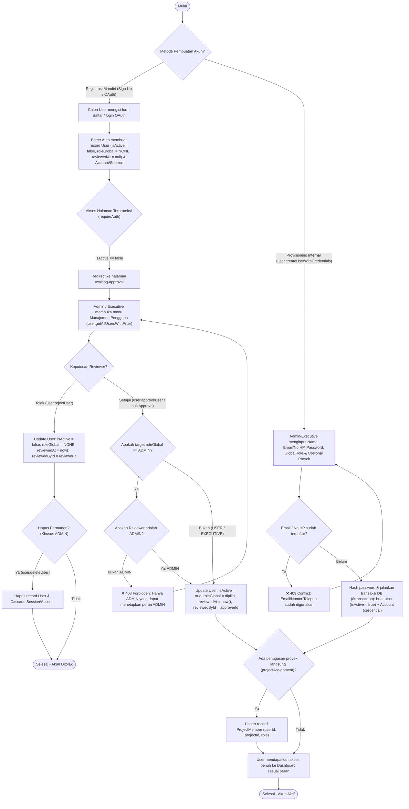
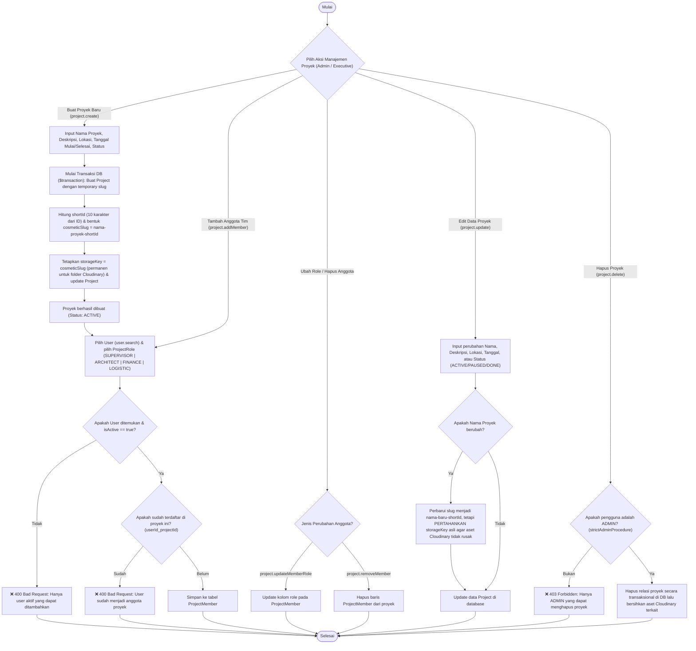
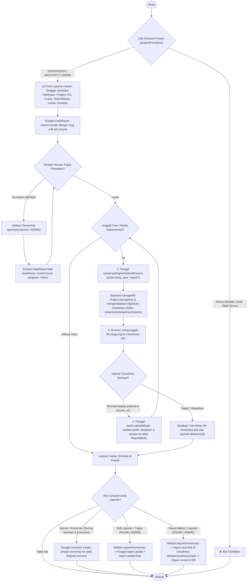
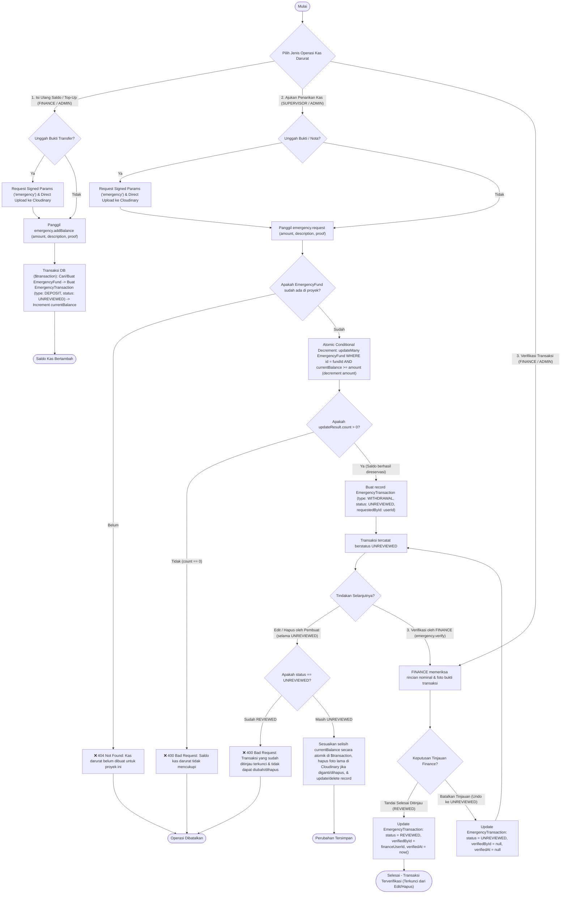
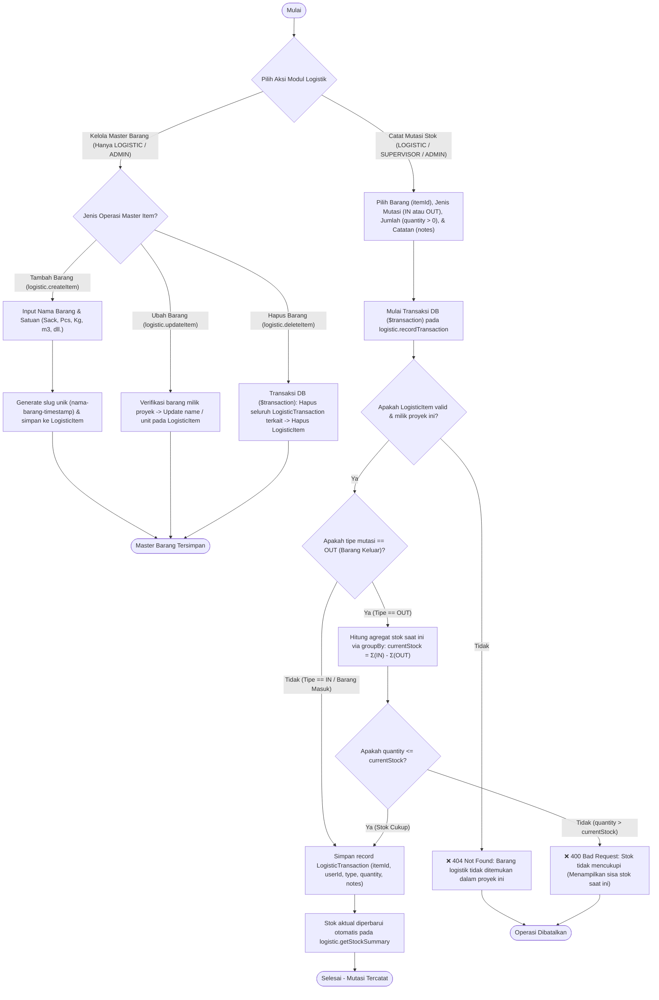
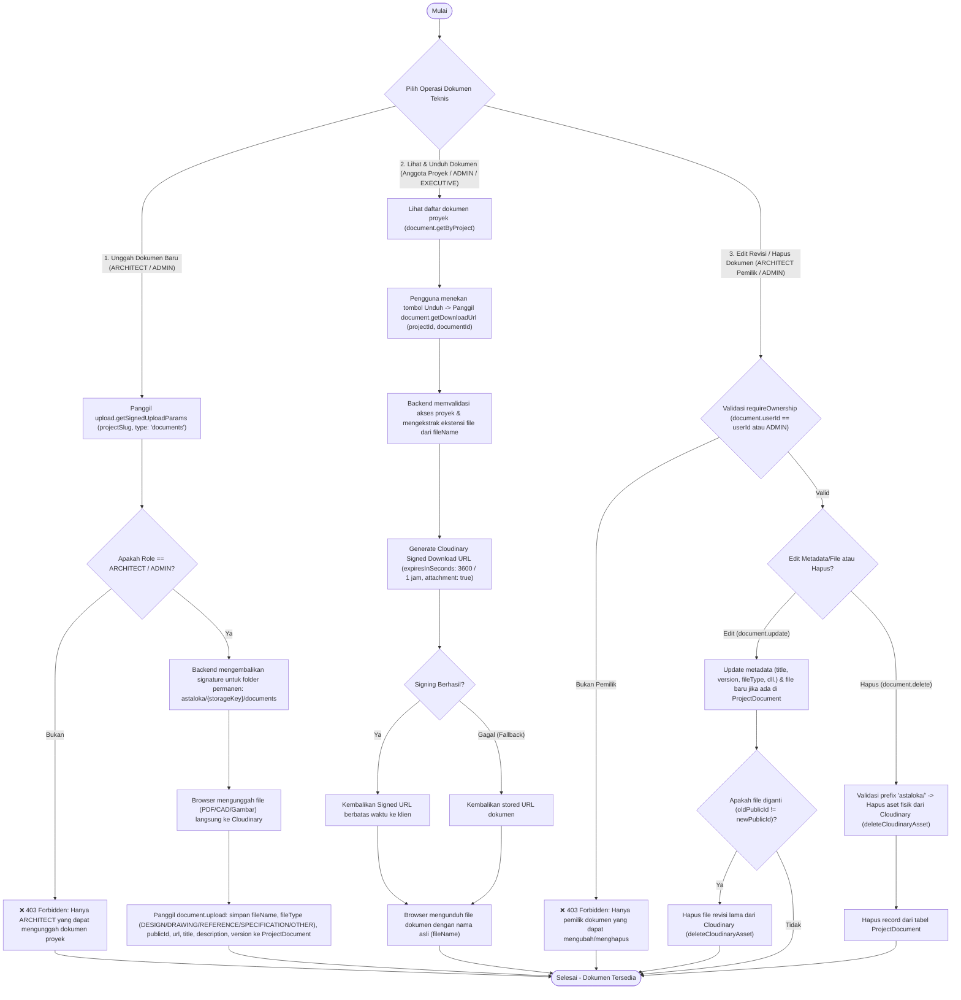

# 📐 Sandaran Internal System — Unified Modeling Language (UML)

> **Dokumentasi Pemodelan Sistem (Use Case Diagram, Activity Diagram, dan Class Diagram) untuk Sandaran Internal System.**  
> Disusun berdasarkan implementasi aktual pada [`prisma/schema.prisma`](../prisma/schema.prisma) dan [`src/server/api/routers/`](../src/server/api/routers/).

---

## Daftar Isi

1. [Use Case Diagram](#1-use-case-diagram)
   - [1.1. Diagram Use Case Sistem](#11-diagram-use-case-sistem)
   - [1.2. Definisi Aktor](#12-definisi-aktor)
   - [1.3. Spesifikasi Use Case](#13-spesifikasi-use-case)
2. [Activity Diagram (6 Alur Proses Bisnis Utama)](#2-activity-diagram-6-alur-proses-bisnis-utama)
   - [2.1. Alur 1: Registrasi, Autentikasi & Persetujuan Pengguna](#21-alur-1-registrasi-autentikasi--persetujuan-pengguna)
   - [2.2. Alur 2: Manajemen Proyek & Penugasan Tim](#22-alur-2-manajemen-proyek--penugasan-tim)
   - [2.3. Alur 3: Laporan Harian, Rincian Tugas & Upload Media](#23-alur-3-laporan-harian-rincian-tugas--upload-media)
   - [2.4. Alur 4: Dana Darurat (Deposit, Withdraw & Verifikasi)](#24-alur-4-dana-darurat-deposit-withdraw--verifikasi)
   - [2.5. Alur 5: Logistik (Master Item & Mutasi Stok IN/OUT)](#25-alur-5-logistik-master-item--mutasi-stok-inout)
   - [2.6. Alur 6: Dokumen Teknis Proyek (Upload, Signed Download & Kelola)](#26-alur-6-dokumen-teknis-proyek-upload-signed-download--kelola)
3. [Class Diagram (Model/Entity + Controller/Service tRPC)](#3-class-diagram-modelentity--controllerservice-trpc)
   - [3.1. Diagram Class Lengkap](#31-diagram-class-lengkap)
   - [3.2. Ringkasan Pemetaan Router tRPC ke Entitas](#32-ringkasan-pemetaan-router-trpc-ke-entitas)

---

## 1. Use Case Diagram

Sistem menggunakan arsitektur otorisasi berlapis (**Global Role** dan **Project Role**). Diagram Use Case di bawah ini memetakan interaksi seluruh aktor terhadap fitur-fitur di dalam batas sistem (*System Boundary*).

### 1.1. Diagram Use Case Sistem

```mermaid
flowchart LR
    %% ==========================================
    %% AKTOR GLOBAL & PROYEK
    %% ==========================================
    subgraph Actors_Global["Aktor Level Global"]
        Guest["👤 Calon Pengguna / User Baru"]
        Admin["🛡️ ADMIN (Administrator)"]
        Exec["📊 EXECUTIVE (Direksi/CEO)"]
    end

    subgraph Actors_Project["Aktor Level Proyek (ProjectMember)"]
        Sup["👷 SUPERVISOR (Pelaksana Lapangan)"]
        Arch["📐 ARCHITECT (Arsitek)"]
        Fin["💰 FINANCE (Keuangan)"]
        Log["📦 LOGISTIC (Logistik/Gudang)"]
    end

    %% ==========================================
    %% SYSTEM BOUNDARY
    %% ==========================================
    subgraph System["Sandaran Internal System"]
        direction TB

        subgraph UC_Auth["1. Autentikasi & Profil"]
            UC01(["UC-01: Registrasi & Login (Email/Phone/OAuth)"])
            UC02(["UC-02: Menunggu Persetujuan (/waiting-approval)"])
            UC03(["UC-03: Kelola Profil & Kata Sandi Sendiri"])
        end

        subgraph UC_Admin["2. Administrasi Sistem & Proyek"]
            UC04(["UC-04: Persetujuan, Penolakan & Provisioning User"])
            UC05(["UC-05: Hapus Akun User Nonaktif"])
            UC06(["UC-06: Buat, Edit & Kelola Proyek"])
            UC07(["UC-07: Hapus Proyek"])
            UC08(["UC-08: Kelola Anggota & Peran Tim Proyek"])
            UC09(["UC-09: Pantau Dashboard & Analitik Lintas Proyek"])
        end

        subgraph UC_Report["3. Modul Laporan Harian"]
            UC10(["UC-10: Buat, Edit & Hapus Laporan Harian Milik Sendiri"])
            UC11(["UC-11: Kelola Rincian Tugas (DailyReportTask)"])
            UC12(["UC-12: Unggah & Hapus Foto Dokumentasi (ReportMedia)"])
            UC13(["UC-13: Lihat Laporan Harian & Galeri Proyek"])
            UC14(["UC-14: Tulis, Edit & Hapus Komentar Laporan"])
        end

        subgraph UC_Emergency["4. Modul Dana Darurat (Kas Kecil)"]
            UC15(["UC-15: Ajukan Penarikan Kas Darurat (WITHDRAWAL)"])
            UC16(["UC-16: Isi Ulang Saldo Kas Proyek (DEPOSIT / Top-Up)"])
            UC17(["UC-17: Verifikasi / Batalkan Tinjauan Transaksi (REVIEWED)"])
            UC18(["UC-18: Lihat Saldo & Riwayat Transaksi Kas"])
        end

        subgraph UC_Logistic["5. Modul Logistik & Material"]
            UC19(["UC-19: Kelola Master Data Barang (CRUD LogisticItem)"])
            UC20(["UC-20: Catat Mutasi Barang Masuk/Keluar (IN / OUT)"])
            UC21(["UC-21: Lihat Ringkasan Stok & Riwayat Mutasi"])
        end

        subgraph UC_Document["6. Modul Dokumen Teknis"]
            UC22(["UC-22: Unggah, Edit & Hapus Dokumen Teknis (CAD/Gambar)"])
            UC23(["UC-23: Lihat & Unduh Dokumen via Signed URL"])
        end

        subgraph UC_Cloud["Layanan Pendukung Internal"]
            UC_Sign(["<<include>> Request Signed Upload Params Cloudinary"])
        end
    end

    %% ==========================================
    %% HUBUNGAN AKTOR KE USE CASE
    %% ==========================================
    %% Guest / User Baru
    Guest --> UC01
    Guest --> UC02

    %% Semua User Aktif dapat mengelola profil sendiri
    Admin --> UC03
    Exec --> UC03
    Sup --> UC03
    Arch --> UC03
    Fin --> UC03
    Log --> UC03

    %% Admin & Executive (Global)
    Admin --> UC04
    Admin --> UC05
    Admin --> UC06
    Admin --> UC07
    Admin --> UC08
    Admin --> UC09

    Exec --> UC04
    Exec --> UC06
    Exec --> UC08
    Exec --> UC09
    Exec --> UC13
    Exec --> UC14
    Exec --> UC18
    Exec --> UC21
    Exec --> UC23

    %% Supervisor
    Sup --> UC10
    Sup --> UC11
    Sup --> UC12
    Sup --> UC13
    Sup --> UC14
    Sup --> UC15
    Sup --> UC18
    Sup --> UC20
    Sup --> UC21
    Sup --> UC23

    %% Architect
    Arch --> UC10
    Arch --> UC11
    Arch --> UC12
    Arch --> UC13
    Arch --> UC14
    Arch --> UC18
    Arch --> UC21
    Arch --> UC22
    Arch --> UC23

    %% Finance
    Fin --> UC13
    Fin --> UC14
    Fin --> UC16
    Fin --> UC17
    Fin --> UC18
    Fin --> UC21
    Fin --> UC23

    %% Logistic
    Log --> UC13
    Log --> UC14
    Log --> UC18
    Log --> UC19
    Log --> UC20
    Log --> UC21
    Log --> UC23

    %% Relasi <<include>> ke Cloudinary Signed Upload
    UC12 -.->|"«include»"| UC_Sign
    UC15 -.->|"«include»"| UC_Sign
    UC16 -.->|"«include»"| UC_Sign
    UC22 -.->|"«include»"| UC_Sign
```

### 1.2. Definisi Aktor

| Aktor                | Level Otorisasi | Deskripsi Peran                                                                                                                                               |
| :------------------- | :-------------- | :------------------------------------------------------------------------------------------------------------------------------------------------------------ |
| **Calon Pengguna**   | Publik / `NONE` | Pengguna yang baru mendaftar dan belum disetujui (`isActive = false`, `roleGlobal = NONE`). Hanya dapat mengakses halaman `/waiting-approval`.                 |
| **ADMIN**            | Global          | Superuser dengan akses penuh ke seluruh prosedur sistem (`strictAdminProcedure` & `adminProcedure`), manajemen pengguna, proyek, dan _bypass ownership_.      |
| **EXECUTIVE**        | Global          | Direksi/eksekutif yang dapat memantau portofolio lintas proyek, menyetujui pengguna non-Admin, mengelola proyek/tim, mengunduh dokumen, dan berkomentar.      |
| **SUPERVISOR**       | Proyek          | Pelaksana lapangan yang membuat laporan harian, mengajukan penarikan kas darurat (`WITHDRAWAL`), serta mencatat mutasi material (`IN`/`OUT`) di lokasi proyek. |
| **ARCHITECT**        | Proyek          | Pengawas teknis & perencana yang membuat laporan pengawasan serta mengunggah dan mengelola dokumen gambar kerja/CAD (`ProjectDocument`).                      |
| **FINANCE**          | Proyek          | Pengendali keuangan proyek yang melakukan pengisian saldo kas darurat (`DEPOSIT`) dan memverifikasi pengajuan penarikan kas (`REVIEWED`).                     |
| **LOGISTIC**         | Proyek          | Pengelola gudang dan rantai pasok yang mengelola master barang (`LogisticItem`) serta mencatat mutasi masuk/keluar material (`LogisticTransaction`).          |

### 1.3. Spesifikasi Use Case

| Kode      | Nama Use Case                               | Router / Prosedur tRPC Terkait                                                        | Aktor yang Berwenang                              |
| :-------- | :------------------------------------------ | :------------------------------------------------------------------------------------ | :------------------------------------------------ |
| **UC-01** | Registrasi & Login                          | Better Auth (`/api/auth/*`)                                                           | Seluruh Pengguna                                  |
| **UC-02** | Menunggu Persetujuan Akun                   | `requireAuth()` guard → `/waiting-approval`                                           | User Baru (`roleGlobal = NONE`)                   |
| **UC-03** | Kelola Profil Sendiri                       | `user.getCurrentUser`, `user.updateProfile`                                           | Seluruh Pengguna Aktif                            |
| **UC-04** | Persetujuan, Penolakan & Provisioning User  | `user.approveUser`, `user.bulkApprove`, `user.rejectUser`, `user.createUserWithCredentials`, `user.updateUser` | `ADMIN`, `EXECUTIVE` (khusus non-Admin)           |
| **UC-05** | Hapus Akun User Nonaktif                    | `user.deleteUser` (`strictAdminProcedure`)                                            | `ADMIN`                                           |
| **UC-06** | Buat & Edit Proyek                          | `project.create`, `project.update`                                                    | `ADMIN`, `EXECUTIVE`                              |
| **UC-07** | Hapus Proyek                                | `project.delete` (`strictAdminProcedure`)                                             | `ADMIN`                                           |
| **UC-08** | Kelola Anggota & Peran Tim Proyek           | `project.addMember`, `project.updateMemberRole`, `project.removeMember`               | `ADMIN`, `EXECUTIVE`                              |
| **UC-09** | Pantau Dashboard & Analitik                 | `dashboard.getAdminOverview`, `dashboard.getExecutiveOverview`, `dashboard.getExecutiveTrends` | `ADMIN`, `EXECUTIVE`                              |
| **UC-10** | Buat, Edit & Hapus Laporan Harian           | `report.create`, `report.update`, `report.delete`                                     | `SUPERVISOR`, `ARCHITECT`, `ADMIN`                |
| **UC-11** | Kelola Rincian Tugas Laporan                | `report.addTask`, `report.updateTask`, `report.deleteTask`                            | `SUPERVISOR`, `ARCHITECT`, `ADMIN` (Pemilik)      |
| **UC-12** | Unggah & Hapus Media Laporan                | `upload.getSignedUploadParams`, `report.uploadMedia`, `report.deleteMedia`            | `SUPERVISOR`, `ARCHITECT`, `ADMIN` (Pemilik)      |
| **UC-13** | Lihat Laporan Harian & Galeri               | `report.getByProject`, `report.getById`, `report.getBySlug`, `report.getGalleryMedia` | Seluruh Anggota Proyek, `ADMIN`, `EXECUTIVE`      |
| **UC-14** | Komentar pada Laporan Harian                | `comment.create`, `comment.getByReport`, `comment.update`, `comment.delete`           | Seluruh Anggota Proyek, `ADMIN`, `EXECUTIVE`      |
| **UC-15** | Ajukan Penarikan Kas Darurat (`WITHDRAWAL`) | `emergency.request`, `emergency.edit`, `emergency.delete`                             | `SUPERVISOR`, `ADMIN`                             |
| **UC-16** | Isi Ulang Saldo Kas Darurat (`DEPOSIT`)     | `emergency.addBalance`, `emergency.edit`, `emergency.delete`                          | `FINANCE`, `ADMIN`                                |
| **UC-17** | Verifikasi Transaksi Kas Darurat            | `emergency.verify`                                                                    | `FINANCE`, `ADMIN`                                |
| **UC-18** | Lihat Saldo & Transaksi Kas Darurat         | `emergency.getByProject`, `emergency.getTransactions`, `emergency.getAnalytics`       | Seluruh Anggota Proyek, `ADMIN`, `EXECUTIVE`      |
| **UC-19** | Kelola Master Barang Logistik               | `logistic.createItem`, `logistic.updateItem`, `logistic.deleteItem`                   | `LOGISTIC`, `ADMIN`                               |
| **UC-20** | Catat Mutasi Barang (`IN` / `OUT`)          | `logistic.recordTransaction`                                                          | `LOGISTIC`, `SUPERVISOR`, `ADMIN`                 |
| **UC-21** | Lihat Stok & Riwayat Mutasi Logistik        | `logistic.getItems`, `logistic.getTransactions`, `logistic.getStockSummary`           | Seluruh Anggota Proyek, `ADMIN`, `EXECUTIVE`      |
| **UC-22** | Unggah, Edit & Hapus Dokumen Teknis         | `upload.getSignedUploadParams`, `document.upload`, `document.update`, `document.delete` | `ARCHITECT`, `ADMIN` (Pemilik)                    |
| **UC-23** | Lihat & Unduh Dokumen Teknis                | `document.getByProject`, `document.getById`, `document.getDownloadUrl`                | Seluruh Anggota Proyek, `ADMIN`, `EXECUTIVE`      |

---

## 2. Activity Diagram (6 Alur Proses Bisnis Utama)

### 2.1. Alur 1: Registrasi, Autentikasi & Persetujuan Pengguna

Menggambarkan proses mulai dari pendaftaran mandiri pengguna atau pembuatan akun langsung oleh Admin (*provisioning*), pemeriksaan *Approval Gate*, hingga penugasan peran global dan proyek.

---

### 2.2. Alur 2: Manajemen Proyek & Penugasan Tim

Menggambarkan proses pembuatan proyek baru dengan mekanisme *Cosmetic Dynamic Slug* dan *Permanent Storage Key*, pembaruan proyek, serta pengelolaan anggota tim proyek (`ProjectMember`).

---

### 2.3. Alur 3: Laporan Harian, Rincian Tugas & Upload Media

Menggambarkan proses pelaporan progres lapangan oleh `SUPERVISOR` atau `ARCHITECT`, penambahan rincian tugas (`DailyReportTask`), pengunggahan foto dokumentasi ke Cloudinary (`ReportMedia`), serta diskusi komentar (`ReportComment`).

---

### 2.4. Alur 4: Dana Darurat (Deposit, Withdraw & Verifikasi)

Menggambarkan siklus pengelolaan kas kecil/darurat proyek (`EmergencyFund`), mulai dari pengisian saldo (`DEPOSIT`) oleh `FINANCE`, pengajuan penarikan dana (`WITHDRAWAL`) oleh `SUPERVISOR` dengan proteksi *race condition* saldo atomik, hingga verifikasi bukti oleh `FINANCE`.

---

### 2.5. Alur 5: Logistik (Master Item & Mutasi Stok IN/OUT)

Menggambarkan pengelolaan master data barang material (`LogisticItem`) oleh `LOGISTIC` serta pencatatan mutasi stok masuk (`IN`) dan keluar (`OUT`) oleh `LOGISTIC` maupun `SUPERVISOR` dengan validasi kecukupan stok secara atomik.

---

### 2.6. Alur 6: Dokumen Teknis Proyek (Upload, Signed Download & Kelola)

Menggambarkan alur pengunggahan dokumen teknis/gambar kerja oleh `ARCHITECT` ke Cloudinary, pembaruan revisi dokumen dengan pembersihan otomatis file lama, serta pengunduhan aman menggunakan *Signed Download URL* berbatas waktu oleh anggota proyek.

---

## 3. Class Diagram (Model/Entity + Controller/Service tRPC)

Diagram Class di bawah ini memodelkan struktur berorientasi objek dari **Sandaran Internal System** yang menggabungkan:
1. **Enumerations (`«enumeration»`)**: 7 tipe enumerasi domain.
2. **Entity / Model Layer (`«entity»`)**: 15 model database Prisma beserta atribut dan tipe datanya.
3. **Controller / Service Layer (`«router»`)**: 9 router tRPC yang mengenkapsulasi seluruh logika bisnis, otorisasi, dan operasi CRUD terhadap entitas.

### 3.1. Diagram Class Lengkap

```mermaid
classDiagram
    direction TB

    %% ==========================================
    %% 1. ENUMERATIONS
    %% ==========================================
    class GlobalRole {
        <<enumeration>>
        ADMIN
        EXECUTIVE
        USER
        NONE
    }

    class ProjectRole {
        <<enumeration>>
        SUPERVISOR
        ARCHITECT
        FINANCE
        LOGISTIC
    }

    class ProjectStatus {
        <<enumeration>>
        ACTIVE
        DONE
        PAUSED
    }

    class TransactionStatus {
        <<enumeration>>
        UNREVIEWED
        REVIEWED
    }

    class TransactionType {
        <<enumeration>>
        DEPOSIT
        WITHDRAWAL
    }

    class LogisticType {
        <<enumeration>>
        IN
        OUT
    }

    class DocumentType {
        <<enumeration>>
        DESIGN
        DRAWING
        REFERENCE
        SPECIFICATION
        OTHER
    }

    %% ==========================================
    %% 2. ENTITY / MODEL CLASSES (PRISMA)
    %% ==========================================
    class User {
        <<entity>>
        +String id
        +String name
        +String email
        +Boolean emailVerified
        +String? image
        +String? phoneNumber
        +Boolean? phoneNumberVerified
        +GlobalRole roleGlobal
        +Boolean isActive
        +DateTime? reviewedAt
        +String? reviewedById
        +DateTime createdAt
        +DateTime updatedAt
    }

    class Session {
        <<entity>>
        +String id
        +DateTime expiresAt
        +String token
        +String? ipAddress
        +String? userAgent
        +String userId
        +DateTime createdAt
        +DateTime updatedAt
    }

    class Account {
        <<entity>>
        +String id
        +String accountId
        +String providerId
        +String userId
        +String? accessToken
        +String? refreshToken
        +String? idToken
        +DateTime? accessTokenExpiresAt
        +DateTime? refreshTokenExpiresAt
        +String? scope
        +String? password
        +DateTime createdAt
        +DateTime updatedAt
    }

    class Verification {
        <<entity>>
        +String id
        +String identifier
        +String value
        +DateTime expiresAt
        +DateTime createdAt
        +DateTime updatedAt
    }

    class Project {
        <<entity>>
        +String id
        +String name
        +String slug
        +String? shortId
        +String? storageKey
        +String? description
        +String? location
        +DateTime? startDate
        +DateTime? endDate
        +ProjectStatus status
        +DateTime createdAt
        +DateTime updatedAt
    }

    class ProjectMember {
        <<entity>>
        +String id
        +String userId
        +String projectId
        +ProjectRole role
        +DateTime createdAt
    }

    class DailyReport {
        <<entity>>
        +String id
        +String slug
        +String projectId
        +String userId
        +DateTime reportDate
        +String taskDescription
        +Int progressPercent
        +String? issues
        +String? weather
        +Int totalWorkers
        +String? location
        +DateTime createdAt
    }

    class DailyReportTask {
        <<entity>>
        +String id
        +String reportId
        +String taskName
        +Int workerCount
        +Int progress
        +String? notes
        +DateTime createdAt
        +DateTime updatedAt
    }

    class ReportMedia {
        <<entity>>
        +String id
        +String reportId
        +String publicId
        +String url
        +String resourceType
        +String? fileName
        +Int? fileSize
        +String? mimeType
        +DateTime createdAt
    }

    class ReportComment {
        <<entity>>
        +String id
        +String reportId
        +String userId
        +String content
        +DateTime createdAt
        +DateTime updatedAt
    }

    class ProjectDocument {
        <<entity>>
        +String id
        +String projectId
        +String userId
        +String fileName
        +DocumentType fileType
        +String publicId
        +String url
        +Int? fileSize
        +String? mimeType
        +String? resourceType
        +String? title
        +String? description
        +String? version
        +DateTime createdAt
        +DateTime updatedAt
    }

    class EmergencyFund {
        <<entity>>
        +String id
        +String projectId
        +Decimal currentBalance
        +DateTime updatedAt
    }

    class EmergencyTransaction {
        <<entity>>
        +String id
        +String fundId
        +String requestedById
        +Decimal amount
        +String description
        +String? publicId
        +String? url
        +TransactionType type
        +TransactionStatus status
        +String? verifiedById
        +DateTime? verifiedAt
        +DateTime createdAt
    }

    class LogisticItem {
        <<entity>>
        +String id
        +String slug
        +String projectId
        +String name
        +String unit
        +DateTime createdAt
    }

    class LogisticTransaction {
        <<entity>>
        +String id
        +String itemId
        +String userId
        +LogisticType type
        +Float quantity
        +String? notes
        +DateTime createdAt
    }

    %% ==========================================
    %% 3. CONTROLLER / SERVICE CLASSES (tRPC ROUTERS)
    %% ==========================================
    class userRouter {
        <<router>>
        +getAllUsersWithFilter(filter, search) User[]
        +getUserDetails(userId) User
        +getCurrentUser() User
        +search(query) User[]
        +approveUser(userId, roleGlobal, projectAssignment) User
        +rejectUser(userId) User
        +bulkApprove(userIds, roleGlobal) BatchPayload
        +deleteUser(userId) User
        +createUserWithCredentials(input) User
        +updateUser(input) User
        +updateProfile(input) User
    }

    class projectRouter {
        <<router>>
        +create(input) Project
        +getAll() Project[]
        +getById(projectId) Project
        +getBySlug(slug) Project
        +update(input) Project
        +delete(projectId) SuccessResponse
        +addMember(projectId, userId, role) ProjectMember
        +updateMemberRole(memberId, role) ProjectMember
        +removeMember(memberId) SuccessResponse
        +getMembers(projectId) ProjectMember[]
    }

    class reportRouter {
        <<router>>
        +create(input) DailyReport
        +getById(projectId, reportId) DailyReport
        +getByProject(projectId, limit, cursor) PaginatedReports
        +getGalleryMedia(projectId, limit, cursor) PaginatedMedia
        +getRecentByProject() ProjectWithReports[]
        +getBySlug(projectId, reportSlug) DailyReport
        +update(input) DailyReport
        +delete(projectId, reportId) SuccessResponse
        +addTask(input) DailyReportTask
        +updateTask(input) DailyReportTask
        +deleteTask(projectId, taskId) SuccessResponse
        +uploadMedia(input) ReportMedia
        +deleteMedia(projectId, mediaId) SuccessResponse
    }

    class commentRouter {
        <<router>>
        +create(projectId, reportId, content) ReportComment
        +getByReport(projectId, reportId) ReportComment[]
        +update(projectId, commentId, content) ReportComment
        +delete(projectId, commentId) SuccessResponse
    }

    class documentRouter {
        <<router>>
        +getAnalytics() DocumentAnalytics[]
        +upload(input) ProjectDocument
        +getByProject(projectId, fileType) ProjectDocument[]
        +getById(projectId, documentId) ProjectDocument
        +getDownloadUrl(projectId, documentId) SignedDownloadResponse
        +update(input) ProjectDocument
        +delete(projectId, documentId) SuccessResponse
    }

    class emergencyRouter {
        <<router>>
        +getAnalytics() EmergencyAnalytics
        +getByProject(projectId) EmergencyFund
        +addBalance(input) EmergencyTransaction
        +request(input) EmergencyTransaction
        +verify(projectId, transactionId, status) EmergencyTransaction
        +edit(input) EmergencyTransaction
        +delete(projectId, transactionId) SuccessResponse
        +getTransactions(projectId, status, type) EmergencyTransaction[]
    }

    class logisticRouter {
        <<router>>
        +getAnalytics() LogisticAnalytics[]
        +createItem(projectId, name, unit) LogisticItem
        +getItems(projectId) LogisticItem[]
        +updateItem(projectId, itemId, name, unit) LogisticItem
        +deleteItem(projectId, itemId) SuccessResponse
        +recordTransaction(projectId, itemId, type, quantity, notes) LogisticTransaction
        +getTransactions(projectId, itemId, type, limit, cursor) PaginatedTransactions
        +getStockSummary(projectId) StockSummary[]
    }

    class uploadRouter {
        <<router>>
        +getSignedUploadParams(projectSlug, type) SignedUploadParams
        +deleteAsset(publicId) SuccessResponse
    }

    class dashboardRouter {
        <<router>>
        +getExecutiveOverview() ExecutiveOverview
        +getExecutiveTrends() ExecutiveTrends
        +getAdminOverview() AdminOverview
        +getUserOverview() UserOverview
    }

    class exportApiRoute {
        <<rest-route>>
        +GET /api/projects/[id]/export?month=YYYY-MM
    }

    %% ==========================================
    %% 4. RELASI ANTAR-ENTITAS (MODEL ASSOCIATIONS)
    %% ==========================================
    User "0..1" --> "0..*" User : reviewedBy / reviews
    User "1" *-- "0..*" Session : sessions
    User "1" *-- "0..*" Account : accounts
    User "1" *-- "0..*" ProjectMember : projectMembers
    Project "1" *-- "0..*" ProjectMember : members

    Project "1" --> "0..*" DailyReport : dailyReports
    User "1" --> "0..*" DailyReport : reports
    DailyReport "1" *-- "0..*" DailyReportTask : tasks
    DailyReport "1" *-- "0..*" ReportMedia : media
    DailyReport "1" *-- "0..*" ReportComment : comments
    User "1" --> "0..*" ReportComment : comments

    Project "1" *-- "0..*" ProjectDocument : documents
    User "1" --> "0..*" ProjectDocument : documents

    Project "1" --> "0..1" EmergencyFund : emergencyFund
    EmergencyFund "1" --> "0..*" EmergencyTransaction : transactions
    User "1" --> "0..*" EmergencyTransaction : requests (RequestedBy)
    User "0..1" --> "0..*" EmergencyTransaction : verifications (VerifiedBy)

    Project "1" --> "0..*" LogisticItem : logistics
    LogisticItem "1" *-- "0..*" LogisticTransaction : transactions
    User "1" --> "0..*" LogisticTransaction : logistics

    %% Relasi ke Enum
    User ..> GlobalRole
    ProjectMember ..> ProjectRole
    Project ..> ProjectStatus
    EmergencyTransaction ..> TransactionStatus
    EmergencyTransaction ..> TransactionType
    LogisticTransaction ..> LogisticType
    ProjectDocument ..> DocumentType

    %% ==========================================
    %% 5. DEPENDENSI ROUTER KE ENTITAS
    %% ==========================================
    userRouter ..> User : manages
    userRouter ..> Account : manages credentials
    userRouter ..> ProjectMember : assigns

    projectRouter ..> Project : manages
    projectRouter ..> ProjectMember : manages team

    reportRouter ..> DailyReport : manages
    reportRouter ..> DailyReportTask : manages
    reportRouter ..> ReportMedia : manages

    commentRouter ..> ReportComment : manages
    documentRouter ..> ProjectDocument : manages

    emergencyRouter ..> EmergencyFund : manages balance
    emergencyRouter ..> EmergencyTransaction : manages tx

    logisticRouter ..> LogisticItem : manages items
    logisticRouter ..> LogisticTransaction : records IN/OUT

    uploadRouter ..> Project : reads storageKey
    dashboardRouter ..> Project : aggregates
    dashboardRouter ..> DailyReport : aggregates
    dashboardRouter ..> EmergencyFund : aggregates
    dashboardRouter ..> LogisticItem : aggregates
```

---

### 3.2. Ringkasan Pemetaan Router tRPC ke Entitas

Tabel berikut menjelaskan tanggung jawab masing-masing class Controller/Service (`tRPC Router`) beserta entitas database dan layanan eksternal yang diaksesnya:

| Class Router (`src/server/api/routers/`) | Entitas Utama yang Dikelola                                      | Integrasi Eksternal / Transaksi Khusus                                                                                                   |
| :--------------------------------------- | :--------------------------------------------------------------- | :--------------------------------------------------------------------------------------------------------------------------------------- |
| **`userRouter`**                         | `User`, `Account`, `ProjectMember`                               | Hashing password (`better-auth/crypto`), proteksi hierarki Admin terakhir, serta transaksi atomik pembuatan akun + penugasan proyek.     |
| **`projectRouter`**                      | `Project`, `ProjectMember`, `EmergencyFund`                      | Pembuatan *Cosmetic Dynamic Slug* (`[nama]-[shortId]`) dan penetapan *Permanent Storage Key* (`storageKey`) satu kali saat inisiasi.     |
| **`reportRouter`**                       | `DailyReport`, `DailyReportTask`, `ReportMedia`                  | Penghapusan paralel aset foto/video di Cloudinary (`Promise.allSettled` + `deleteCloudinaryAsset`) sebelum menghapus laporan dari DB.    |
| **`commentRouter`**                      | `ReportComment`, `DailyReport`                                   | Diskusi lintas-peran dengan dukungan khusus `allowExecutive: true` bagi peran `EXECUTIVE`.                                               |
| **`documentRouter`**                     | `ProjectDocument`                                                | Pembuatan *Signed Download URL* berbatas waktu 1 jam (`generateSignedDownloadUrl`) dan pembersihan otomatis file revisi lama.            |
| **`emergencyRouter`**                    | `EmergencyFund`, `EmergencyTransaction`                          | Pembaruan saldo kas menggunakan *Atomic Conditional Decrement/Increment* (`updateMany` dengan klausa `gte`) untuk mencegah *race condition*. |
| **`logisticRouter`**                     | `LogisticItem`, `LogisticTransaction`                            | Kalkulasi stok *real-time* (`Σ IN - Σ OUT`) di dalam `$transaction` sebelum mengizinkan transaksi barang keluar (`OUT`).                 |
| **`uploadRouter`**                       | `Project`, `ProjectDocument`, `ReportMedia`, `EmergencyTransaction` | Penandatanganan parameter unggahan klien (*Direct Signed Upload*) ke folder `astaloka/{storageKey}/{type}` dan validasi kepemilikan aset. |
| **`dashboardRouter`**                    | `Project`, `User`, `DailyReport`, `EmergencyFund`, `LogisticItem` | Agregasi paralel (`Promise.all`) untuk KPI Eksekutif, tren tenaga kerja 30 hari, arus kas 6 bulan, dan indikator kesehatan proyek Admin. |
